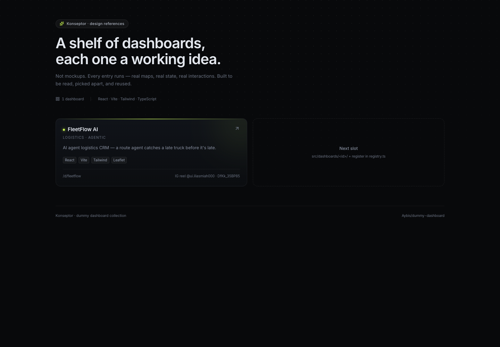
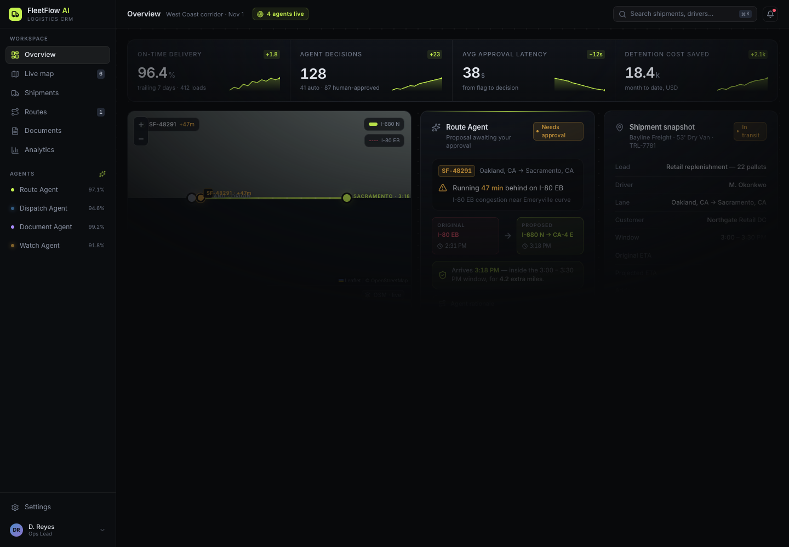

# Konseptor

A shelf of dummy dashboards — each one a working idea, not a screenshot.

Every entry here actually runs: real maps, real state, real interactions.
Built to be read, picked apart, and reused as a design reference.

**Live gallery:** open `#/` — pick a dashboard, it loads in place.

---

## Index

| # | Dashboard | Category | Route | Stack |
|---|-----------|----------|-------|-------|
| 1 | **FleetFlow AI** | Logistics · Agentic | `#/d/fleetflow` | React · Vite · Tailwind · Leaflet |

### 1. FleetFlow AI

AI agent logistics CRM. The Route Agent flags shipment `SF-48291` running
47 minutes behind on I-80, proposes a reroute to I-680, and lands it inside
the customer's 3:00–3:30 PM window for 4.2 extra miles. One approval, and the
decision is logged with who approved it and why.

- **Decision surface, not a stats wall** — the agent proposal is the centre
  of the layout; KPIs are framing, not the point.
- **Real Leaflet map** with dual route polylines (I-80 congested vs I-680
  proposed), custom markers, animated overlay.
- **Working Approve / Decline** — state transitions, decision receipt, reset.
  Verified in browser.
- Dark surface scale + single lime accent, tabular numerics throughout.

| Gallery | Dashboard |
|---|---|
|  |  |

Source: IG reel [@ui.iliasmiah000](https://www.instagram.com/reel/DfKk_35BP85/)

---

## Run

```bash
npm install
npm run dev      # http://localhost:5173
npm run build    # tsc -b + vite build — must stay clean
```

---

## Adding a dashboard

The collection is a single Vite app. Each dashboard is a folder; the gallery
and the router both read one registry.

```
src/
├── dashboards/
│   ├── registry.ts          ← the list (id, meta, component)
│   └── fleetflow/
│       ├── FleetFlow.tsx    ← default export
│       ├── components/
│       └── data/
├── Gallery.tsx              ← the shelf
├── App.tsx                  ← hash router: #/ and #/d/<id>
└── index.css                ← shared tokens + Leaflet overrides
```

1. Create `src/dashboards/<id>/` exporting a default component.
2. Register it in `src/dashboards/registry.ts`:

```ts
{
  id: "my-dashboard",              // url segment
  name: "My Dashboard",
  tagline: "One line on what makes it interesting.",
  category: "Finance · Analytics",
  stack: ["React", "Tailwind"],
  accent: "#5aa9f5",               // shows on the gallery card
  source: "where the design came from",
  component: MyDashboard,
}
```

3. Route is `#/d/my-dashboard` automatically. Nothing else to wire.

### Conventions

- **Dashboards own their chrome.** Sidebar, topbar, tokens live inside the
  dashboard folder — the gallery stays neutral so no dashboard's palette
  bleeds into the shelf.
- **Shared primitives go in the dashboard**, not global, unless a second
  dashboard needs them. Premature sharing is how these collections rot.
- **Data is hardcoded and honest.** These are design references; a fake API
  layer adds noise without adding understanding.
- **`npm run build` must pass** before committing an entry.

---

## Notes

- Hash routing by design — works on any static host, no rewrite rules.
- Leaflet tile dark-mode is a calibrated CSS filter, not a paid tile provider.
  OSM tiles are ~80% pure white, so `invert(1)` alone renders a black square;
  the working recipe is in `src/index.css`.
- Fonts loaded from Google Fonts (Inter, JetBrains Mono). Offline builds fall
  back to system stacks without layout shift.

---

Repo: [Aybis/dummy-dashboard](https://github.com/Aybis/dummy-dashboard)
